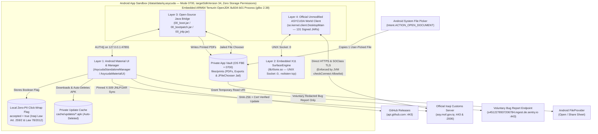

# Security Policy & Architecture Transparency

[](https://sonarcloud.io/summary/new_code?id=MohammedALShimmary_ASYCUDA-Iraq-Android)
[](https://sonarcloud.io/summary/new_code?id=MohammedALShimmary_ASYCUDA-Iraq-Android)
[](https://sonarcloud.io/summary/new_code?id=MohammedALShimmary_ASYCUDA-Iraq-Android)
[](https://sonarcloud.io/summary/new_code?id=MohammedALShimmary_ASYCUDA-Iraq-Android)
[](https://sonarcloud.io/summary/new_code?id=MohammedALShimmary_ASYCUDA-Iraq-Android)
[](https://sonarcloud.io/summary/new_code?id=MohammedALShimmary_ASYCUDA-Iraq-Android)

Because **ASYCUDA World — Republic of Iraq (Android)** (`iq.asycuda`) is an independent, open-source desktop runtime wrapper used by licensed customs brokers and logistics operators, security and source-code transparency are treated as first-order engineering requirements.

---

## Supported Versions & Published Release Verification (`v4.1.0`)

All users should run **[v4.1.0](https://github.com/MohammedALShimmary/ASYCUDA-Iraq-Android/releases/tag/v4.1.0)** (`versionCode 43`). Earlier releases (`v4.0.5`, `v4.0.0`, `v3.9.5`, `v3.9.0`, `v3.8.0`, `v3.7.0`, and `v3.6.0`) have been marked as superseded on GitHub Releases following the `v4.1.0` Dynamic Host/Port Resolution, Hardened JVM Sandbox, One-Way Clipboard Paste, and Startup Cryptographic JAR Verification upgrade.

| Version | Supported | Security Status | Direct Release Link |
| :--- | :--- | :--- | :--- |
| **v4.1.0** (`versionCode 43`) | **Yes (Recommended)** | **Dynamic Host & Port Discovery** (zero hardcoded server IPs or fallback ports; dynamically parsed from `AWIQWorld.jnlp` and resolved via system DNS), **Hardened Fail-Closed JVM Sandbox** (canonical path protection, read-only JAR immutability, explicit JRE native library allowlist, full-stack reflection & environment variable isolation), **One-Way Clipboard Paste** (`Android -> ASYCUDA` only with zero clipboard/keystroke logging), **Zero-PII Iraqi Law Click-Wrap Liability Waiver** (Iraqi Civil Code Art. 259/2 & Electronic Transactions Law No. 78/2012 Art. 18/1), **Zero pre-bundled government JARs** (downloaded directly from `asy.mof.gov.iq` & verified against `SOCODE.RSA` on every startup), **Android 14 (`targetSdkVersion 34`)**, **Zero storage permissions**, X11 `-nolisten tcp`, 100% In-RAM diagnostic preview with auto-zeroing, Eclipse Temurin OpenJDK `8u504-b01` LTS, 7-Suite Adversarial CI Security Verification & CycloneDX SBOM | [**GitHub Release `v4.1.0`**](https://github.com/MohammedALShimmary/ASYCUDA-Iraq-Android/releases/tag/v4.1.0) |
| **< v4.1.0** (`v4.0.5`, `v4.0.0`, `v3.9.5`, `v3.9.0`, `v3.8.0`, `v3.7.0`, `v3.6.0`) | No | Superseded — upgrade to **v4.1.0** via the in-app Update Center or direct APK download | [Download `ASYCUDA_Iraq_v4.1.0.apk`](https://github.com/MohammedALShimmary/ASYCUDA-Iraq-Android/releases/download/v4.1.0/ASYCUDA_Iraq_v4.1.0.apk) |

### Official `v4.1.0` Release Assets & SHA-256 Checksums
Every asset published on the [official `v4.1.0` GitHub Release](https://github.com/MohammedALShimmary/ASYCUDA-Iraq-Android/releases/tag/v4.1.0) can be verified via `sha256sum`:

| Release Asset | Purpose | SHA-256 Checksum |
| :--- | :--- | :--- |
| [**`ASYCUDA_Iraq_v4.1.0.apk`**](https://github.com/MohammedALShimmary/ASYCUDA-Iraq-Android/releases/download/v4.1.0/ASYCUDA_Iraq_v4.1.0.apk) | Signed Android release APK (`iq.asycuda`, `versionCode 43`, `targetSdkVersion 34`) | `TBD_ON_RELEASE_BUILD` |
| [**`asycuda-iraq.tar.xz`**](https://github.com/MohammedALShimmary/ASYCUDA-Iraq-Android/releases/download/v4.1.0/asycuda-iraq.tar.xz) | Open-source `java-bridge/` JARs (`00_bootpatch.jar`, `00_boot.jar`, `00_jnlp.jar`) & config (`zero` government JARs bundled; all official JARs are downloaded directly from `asy.mof.gov.iq` on first launch) | `e74ac5883c8b2fa1ac6554bedc80feaa9e0baa106700dc948d88708c8d2abac2` |
| [**`runtime-arm64.tar.xz`**](https://github.com/MohammedALShimmary/ASYCUDA-Iraq-Android/releases/download/v4.1.0/runtime-arm64.tar.xz) | Embedded ARM64 glibc 2.38 + Eclipse Temurin OpenJDK `8u504-b01` LTS (`1.8.0_504-b01`) runtime environment | `f3dc78325792ea764e82d108b54dfc6fe4d6d9fd752bafc83bb780403286b9c1` |
| [**`sbom.cdx.json`**](sbom.cdx.json) | CycloneDX 1.5 Software Bill of Materials (Android Maven + ARM64 Runtime + Government JARs) | Tracked in repository root |

### Official APK X.509 Signing Certificate Fingerprint
Every official release APK (`ASYCUDA_Iraq_v4.1.0.apk`) can be cryptographically verified prior to installation using `apksigner verify --print-certs`:

| Field | Value |
| :--- | :--- |
| **Application ID** | `iq.asycuda` |
| **Version Name / Code** | `4.1.0` (`versionCode 43`) |
| **Signer Certificate DN** | `CN=Mohammed Ammar Hussein, OU=Logistics and Customs Software, O=ASYCUDA Iraq Open Source, L=Baghdad, ST=Baghdad, C=IQ` |
| **Signer SHA-256 Digest** | `d302d4d050fb986e4088dd3e684c90662d00da748dde8da3d4966baea02da023` |
| **Signer SHA-1 Digest** | `e1b9c91b50e50223885fd2ee5326b165f16535e7` |

---

## 1. 4-Layer Architecture & Data-Flow Matrix

To prevent any confusion about which component performs which action, the application is strictly separated into four isolated layers:

| Layer | Component | Source Location | Trust & Storage Boundary | Network Access |
| :--- | :--- | :--- | :--- | :--- |
| **Layer 1: Android UI & Lifecycle Manager** | `MainActivity`, `AsycudaStandaloneManager`, `AsycudaMaterialUi` | `lorie/src/main/java/com/termux/x11/` | Runs inside Android app UID (`0700` `/data/data/iq.asycuda/`, `targetSdkVersion 34`). Zero broad storage permissions (`MANAGE_EXTERNAL_STORAGE` removed). Stores first-launch Terms acceptance strictly as a local boolean flag (zero personal data collected). | • `asy.mof.gov.iq:443` (JNLP/JAR sync)<br>• `api.github.com:443` (APK release check)<br>• `o4512278937206784.ingest.de.sentry.io:443` (Voluntary user-submitted bug reports only)<br>• `sonarcloud.io` / `snyk.io` (About dialog badges) |
| **Layer 2: Native X11 Display Surface** | `libXlorie.so` (Termux:X11) | `lorie/src/main/cpp/` | Renders the local UNIX domain X11 socket (`/data/data/iq.asycuda/files/usr/tmp/.X11-unix/X0`, `0700`) onto an Android `SurfaceView` with TCP listening disabled (`-nolisten tcp`). | **None** (100% local UNIX socket, `-nolisten tcp`) |
| **Layer 3: Open-Source Java-to-Android Bridge** | `00_bootpatch.jar`, `00_boot.jar`, `00_jnlp.jar` | [`java-bridge/`](java-bridge/) | Intercepts desktop printing (`ASYCUDA_PDF_Printer`), `.so` document exports, and `JFileChooser` file imports inside the JVM, jailing all files to `/data/data/iq.asycuda/files/prints` (OS FBE + `0700` UID Sandbox), blocking JVM access to `/shared_prefs`, and enforcing a strict JVM `checkConnect` outbound network allowlist (`localhost` and `asy.mof.gov.iq` only). Communicates with Layer 1 over `127.0.0.1:47891` using per-session `AUTH|<UUID>|` tokens. | **None** (`127.0.0.1:47891` loopback only) |
| **Layer 4: Official Iraqi Customs Client** | `so.kernel.client.DesktopMain` (131 signed `.jar` files) | Downloaded on first launch from `https://asy.mof.gov.iq/aw/AWIQWorld.jnlp` | Zero government JARs are bundled in the APK. Downloaded directly from `asy.mof.gov.iq` and verified against UNCTAD/StrategyObject's pinned X.509 certificate (`META-INF/SOCODE.RSA`). Handles all customs logins, declarations, and tariff tables. | Direct connection to **`asy.mof.gov.iq:443`** and **`asy.mof.gov.iq:2006`** (enforced at runtime by `AsycudaBoot.checkAllowedOutboundNetwork()`) |



---

## 2. Zero Storage Permissions, Unified Private Vault & Automatic File Picker Bridge (`v4.0.5`)

1. **Zero Broad Storage or Accessibility Permissions (`AndroidManifest.xml`)**:
   - `MANAGE_EXTERNAL_STORAGE`, `READ_EXTERNAL_STORAGE`, `WRITE_EXTERNAL_STORAGE`, `ACCESS_WIFI_STATE`, `CHANGE_WIFI_STATE`, and `BIND_ACCESSIBILITY_SERVICE` have been **completely removed** from [`lorie/src/main/AndroidManifest.xml`](lorie/src/main/AndroidManifest.xml) (enforced on every commit by [`scripts/SecurityVerificationTest.java`](scripts/SecurityVerificationTest.java)).
   - Below is the **complete inventory of all 9 permissions** declared in `AndroidManifest.xml` and their exact engineering purpose:

   | Declared Permission | Android Protection Level | Exact Engineering Purpose |
   | :--- | :--- | :--- |
   | `android.permission.INTERNET` | Normal | Connects directly to the Iraqi Customs server (`asy.mof.gov.iq`), checks for GitHub release updates, and sends voluntary user-submitted bug reports. |
   | `android.permission.ACCESS_NETWORK_STATE` | Normal | Monitors active Wi-Fi and 4G network interfaces (`ConnectivityManager.getActiveNetwork()`) for seamless network handover and `AWIQWorld.jnlp` package synchronization. |
   | `android.permission.FOREGROUND_SERVICE` | Normal | Keeps the embedded X11 display server and ASYCUDA JVM alive while the user switches briefly to another app (e.g. viewing an exported PDF). |
   | `android.permission.FOREGROUND_SERVICE_SPECIAL_USE` | Normal (Android 14 / SDK 34) | Required by Android 14 (`targetSdkVersion 34`) for persistent local desktop/X11 sessions. |
   | `android.permission.WAKE_LOCK` | Normal | Prevents CPU sleep during active customs declaration submission or multi-JAR synchronization. |
   | `android.permission.REQUEST_IGNORE_BATTERY_OPTIMIZATIONS` | Normal / User-Gated | Allows customs brokers to exempt the active X11/JVM desktop session from aggressive OEM background battery killers during multi-hour declarations. |
   | `android.permission.POST_NOTIFICATIONS` | Runtime (Optional) | Displays the foreground X11 session status notification (`Exit` action button). |
   | `android.permission.REQUEST_INSTALL_PACKAGES` | Signature / User-Gated | Used **exclusively** when the user taps **"Download & Install App Update"** inside the Update Center after the downloaded GitHub Release `.apk` passes both SHA-256 digest and X.509 developer certificate pinning verification. Android always prompts the user for explicit confirmation before installing. |
   | `iq.asycuda.PERMISSION_INTERNAL_BROADCAST` | `signature` (App-Private) | Custom `signature`-level permission protecting internal X11 surface state broadcasts between `CmdEntryPoint` and `MainActivity` so no third-party app can spoof or intercept internal display intents. |
2. **Automatic File Picker Bridge (`Zero Modification to Government Dialogs`)**:
   - Because the legacy ASYCUDA Java 8 Swing client uses `javax.swing.JFileChooser` / `java.awt.FileDialog` (which cannot invoke Android `content://` intents directly), [`AsycudaBoot.java`](java-bridge/AsycudaBoot.java) jails `JFileChooser` and `FileDialog` strictly to the unified private Vault folder `/data/data/iq.asycuda/files/prints` using `VaultFileSystemView` (preventing traversal to parent system folders while allowing subfolder management inside the Vault).
   - No buttons or custom UI components are ever injected into ASYCUDA's `JFileChooser`. Instead, when ASYCUDA opens its file chooser, `AsycudaBoot` sends `AUTH|<token>|PICK_WORKSPACE_FILE` over `127.0.0.1:47891` to `AsycudaStandaloneManager`, which displays a compact Android prompt (`showFilePickerBridgePromptModal`) asking whether the user wants to **Import a new file from their phone into the Vault** (`Intent.ACTION_OPEN_DOCUMENT`) or **Use a file already in the Vault**.
   - When the user imports a file from their phone, only that single chosen file is copied into `/data/data/iq.asycuda/files/prints/` and automatically highlighted inside the open Java `JFileChooser` dialog.
3. **Full-Featured Private Vault — File Manager (`Folders`, `Copy`, `Move`, `Open`, `Share`, `Delete` & `Upload Staging Exclusion`)**:
   - All printed PDFs, exported customs documents, and imported attachments are stored **exclusively** inside `/data/data/iq.asycuda/files/prints` (protected by Android's kernel-enforced `0700` UID sandbox and OS File-Based Encryption). Zero files are ever written to public `/storage/emulated/0/Download`.
   - Inside the in-app **Vault — File Manager** (`showVaultFileManagerModal`), users can create subfolders, navigate into and out of folders, **Copy** or **Move** files and folders between locations, **Open**, **Share** (files only—folders are strictly prevented from being shared), or **Delete** items via Apple-style icon buttons and multi-select batch actions.
   - **Upload Staging Exclusion**: Temporary `soems*ems` and `prn*xc` upload staging files in `/client/tmp/` (and any file already present in the Vault tree by name+size or SHA-256 digest via `isFileAlreadyInVault`) are ignored by the print/export watcher so uploading an attachment to the customs server never triggers duplicate Vault saves or file-open dialogs.
4. **Private Cache & Automatic Cleanup for In-App APK Updates**:
   - When installing an app update via the **Update Center**, `downloadAndInstallApkUpdate()` downloads the `.apk` into `/data/data/iq.asycuda/cache/updates/` (never into `files/prints` or public storage), verifies its SHA-256 digest and X.509 signing certificate, launches the Android package installer, and `cleanupStaleUpdateApks()` automatically deletes the `.apk` file on startup once the update completes.

---

## 3. Data Privacy, Zero-PII Iraqi Law Click-Wrap Liability Waiver & External Network Inventory

1. **Zero Credential & Zero Personal Data Collection**:
   - The Android wrapper **never** intercepts, inspects, stores, or transmits your ASYCUDA World username, password, two-factor codes, or customs declaration data.
   - The application collects **zero personal names, zero company names, and zero hardware device IDs (`ANDROID_ID`)**.
   - All authentication and customs operations take place inside the official ASYCUDA World Java client (`so.kernel.client.DesktopMain`) communicating directly with the Iraqi Ministry of Finance server (`https://asy.mof.gov.iq` and `//asy.mof.gov.iq:2006/`), enforced at the JVM socket layer by `AsycudaBoot.checkAllowedOutboundNetwork()`.
2. **Binding First-Launch Click-Wrap Liability Waiver Under Iraqi Law (Zero PII Transmitted)**:
   - To protect both the user and the open-source developer without collecting any personal data, the application presents a mandatory first-launch **Click-Wrap Terms & Conditions and Contractual Liability Waiver** (`showTermsAndConditionsModal()`).
   - **Legal Foundation Under Iraqi Law**:
     1. **Article 259(2) of the Iraqi Civil Code No. 40 of 1951 (`المادة 259/2 من القانون المدني العراقي رقم 40 لسنة 1951`)**: Explicitly permits contractual exemption from liability (`يجوز الاتفاق على إعفاء المدين من أية مسؤولية تترتب على عدم تنفيذ التزامه التعاقدي...`), reinforced by the gratuitous (`تبرعي / بدون عوض مالي`) nature of this free GPL v3 open-source software.
     2. **Article 18(1) & Article 13 of the Iraqi Electronic Signature and Electronic Transactions Law No. 78 of 2012 (`قانون التوقيع الإلكتروني والمعاملات الإلكترونية العراقي رقم 78 لسنة 2012`)**: Recognizes the full legal validity and binding evidentiary force of electronic contracts formed by electronic offer and click-wrap acceptance (`الإيجاب والقبول الإلكتروني`).
   - **Technological Gate (`Conclusive Proof by Operation`)**: Because `AsycudaStandaloneManager.java` technologically blocks the runtime from booting until `hasAcceptedTerms(activity)` is `true`, the act of running the application itself is conclusive proof that the user ticked the mandatory agreement checkbox and clicked **"Accept & Continue"**. Acceptance is stored **strictly as a local boolean flag (`accepted = true`) on the user's device — zero personal data or consent receipts are ever transmitted to Sentry or any external server**.
3. **Voluntary User Bug Reports, Optional Screenshots & Private Developer-Only Sentry Links**:
   - Diagnostic bundles (`buildDiagnosticsZipBytes()`) are assembled strictly in RAM (`ByteArrayOutputStream`) and streamed directly over HTTPS to Sentry **only** when the user explicitly opens *"Report a Technical Issue"* and taps **"Submit Report"**. **No diagnostic `.zip` file is ever written to internal or external storage**.
   - **Optional Screenshot with Explicit UI Warning**: Attaching a screenshot in *"Report a Technical Issue"* is **100% optional** (explicitly labeled `"Screenshot or Image (Optional)"` / `"صورة للشاشة أو الخطأ (اختياري)"` in `AsycudaMaterialUi.java`) and displays a prominent orange/yellow privacy notice (`#FFFF9F0A`): *"Privacy Notice: Do not attach screenshots showing visible passwords, TINs, or confidential live customs declarations."*
   - **How `.github/workflows/sentry-to-github-issues.yml` Works (Attachments Are Never Public)**: When a user submits a bug report, `.github/workflows/sentry-to-github-issues.yml` mirrors only the **scrubbed text description and device model/OS metadata** to GitHub Issues for transparent issue tracking. **Screenshots and diagnostic log attachments are NEVER uploaded to GitHub Issues** — the GitHub Issue contains only a reference link to the private Sentry event (`https://mohammed-ammar-hussein.sentry.io/...`), which requires the developer's private Sentry authentication and is completely inaccessible to the public.
   - Before any text is placed in the Sentry envelope, `redactSensitiveLogContent()` scrubs local IPC tokens, URL credentials, `Bearer`/`Basic` tokens, XML/SOAP auth tags (`<password>`, `<user>`, `<username>`, `<tin>`, `<declarant>`, `<token>`, `<jsessionid>`), and both quoted JSON strings and unquoted key-value patterns for usernames, passwords, TINs, cookies, and session tokens.
4. **Complete Inventory of External Network Endpoints**:

   | Hostname / Endpoint | Protocol | Direction | Purpose & Data Transmitted |
   | :--- | :--- | :--- | :--- |
   | **`asy.mof.gov.iq`** (`:443` & `:2006`) | HTTPS / SOClass TLS | Read/Write | Official Iraqi General Commission of Customs ASYCUDA World server (`AWIQWorld.jnlp`, signed government `.jar` packages, and live customs session). |
   | **`api.github.com`** & **`github.com`** | HTTPS (`443`) | Read-Only (`GET`) | Fetches the latest open-source release metadata (`releases/latest`) and downloads `ASYCUDA_Iraq_vX.Y.Z.apk` when the user installs an app update. |
   | **`o4512278937206784.ingest.de.sentry.io`** | HTTPS (`443`) | Write-Only (`POST`) | Used **solely** when a user manually submits a voluntary bug report via *"Report a Technical Issue"* (zero automatic background telemetry and zero first-launch consent uploads). |
   | **`sonarcloud.io`** & **`snyk.io`** | HTTPS (`443`) | Read-Only (`GET`) | Queries public code-quality and security badge status solely when the user opens the **About & Security Verification** dialog. Sends zero user or device data. |

---

## 4. Full Transparency of Custom Java-to-Android Bridge JARs (`java-bridge/`)

Every line of `.java` source code for the three compatibility JARs—and the script to compile them from scratch—is published in [`java-bridge/`](java-bridge/):

| Bridge Archive | Source Files | Purpose |
| :--- | :--- | :--- |
| **`00_bootpatch.jar`** | [`java-bridge/bootpatch/java/awt/Desktop.java`](java-bridge/bootpatch/java/awt/Desktop.java) | Loaded via `-Xbootclasspath/p:00_bootpatch.jar`. Intercepts `Desktop.getDesktop().open(File)` and `.browse(URI)` inside the headless Linux JVM and forwards them to `AsycudaBoot.handleDesktopAction()`. |
| **`jars/00_jnlp.jar`** | [`java-bridge/jnlp/javax/jnlp/BasicService.java`](java-bridge/jnlp/javax/jnlp/BasicService.java)<br>[`java-bridge/jnlp/javax/jnlp/ServiceManager.java`](java-bridge/jnlp/javax/jnlp/ServiceManager.java)<br>[`java-bridge/jnlp/javax/jnlp/UnavailableServiceException.java`](java-bridge/jnlp/javax/jnlp/UnavailableServiceException.java) | Provides the `javax.jnlp.ServiceManager` and `BasicService` API expected by `client.jar` when running outside Oracle's desktop `javaws` launcher, routing `showDocument(URL)` to the Android bridge. |
| **`jars/00_boot.jar`** | [`java-bridge/AsycudaBoot.java`](java-bridge/AsycudaBoot.java) | Pre-main wrapper that:<br>• Registers a pure-Java PDF 1.4 print service (`ASYCUDA_PDF_Printer`) saving printed declarations exclusively in `/data/data/iq.asycuda/files/prints`.<br>• Jails `JFileChooser` and `FileDialog` to `/data/data/iq.asycuda/files/prints` via `VaultFileSystemView` and sends `PICK_WORKSPACE_FILE` so users can import files via Android's native file picker without storage permissions.<br>• Watches for temporary `.so` files exported by ASYCUDA (excluding `soems*ems` / `prn*xc` upload staging files), detects their real file type (`PDF`, `XLSX`, `DOCX`, `XML`, `JPG`, `PNG`) via magic-byte headers and SHA-256 deduplication, and opens them on Android.<br>• Hooks `so.rmi.transport.client.ClientTransportLayer`'s `RejectHandler` for `"SOClass Client have to be updated"` alerts, guards `so.kernel.client.Resources.multiLinguisticListeners` (`VisualFacetJTableSDS.updateComponent`) during UI language switches, and filters benign `R_Load_SadItmAdm` / `R_Load_HisWriteOff` NPE popups.<br>• Installs a hardened `SecurityManager` (`createHardenedSecurityManager()`) that explicitly **blocks OS subprocess execution** (`checkExec()` throws `SecurityException`), **blocks JVM access to Android host storage paths** (`checkBlockedHostPath()` blocks `/shared_prefs`, `/databases/`, `/datastore/`), and **enforces an outbound network allowlist** (`checkConnect()` / `checkAllowedOutboundNetwork()` restricts all JVM sockets strictly to `localhost`/`127.0.0.1` and `asy.mof.gov.iq`, throwing `SecurityException` for any other host or IP).<br>• Invokes the official `so.kernel.client.DesktopMain.main(args)`. |

To rebuild and verify all three JARs from source:

```bash
./java-bridge/build-bridge.sh
```

### Native Binary & Runtime Provenance (`jniLibs` & `runtime-arm64.tar.xz`)
For complete supply-chain transparency, every native ARM64 binary packaged in the application originates from verifiable open-source builds:
1. **`lorie-app/src/main/jniLibs/arm64-v8a/libld_linux_aarch64.so`** (`SHA-256: 0ca57a7e0b97562569bf91d88ef0f3971ab34957e50bf2cf5282c81fe9c0c4ab`): Unmodified GNU C Library (`glibc 2.38`) dynamic ELF linker (`ld-linux-aarch64.so.1`) from `@Maxython/glibc-packages` for Termux ARM64, packaged inside `jniLibs/arm64-v8a/` so Android 10–14 (`targetSdkVersion 34`) extracts it into the SELinux `apk_data_file` execute-allowed `nativeLibraryDir`.
2. **`libXlorie.so`**: Built directly from source in [`lorie/src/main/cpp/`](lorie/src/main/cpp/) during the Gradle NDK build (`CMakeLists.txt`).
3. **`runtime-arm64.tar.xz`** (`SHA-256: f3dc78325792ea764e82d108b54dfc6fe4d6d9fd752bafc83bb780403286b9c1`): Contains the unmodified **Eclipse Temurin OpenJDK `8u504-b01` LTS** (`aarch64` Linux) JRE and standard X.Org client libraries (`libX11`, `libXext`, `libXrender`, `libXtst`, `libfreetype`).

---

## 5. Cryptographic Verification, Adversarial Security Suite & Independent Runtime Network Audit

### 5.1 Pinned UNCTAD/SOClass Publisher Certificate (`PINNED_MOF_SOCODE_CERT_SHA256`)
Every official ASYCUDA World JAR published on `asy.mof.gov.iq/aw/` is signed by UNCTAD/StrategyObject (`META-INF/SOCODE.RSA` / `META-INF/SOCODE.SF`). Before any downloaded `.jar.tmp` file is renamed into `asycuda/jars/`, `verifyDownloadedJarIntegrity(File jarFile)` enforces three mandatory cryptographic checks:
1. Verifies that the archive contains both `META-INF/SOCODE.RSA` and `META-INF/SOCODE.SF` and parses the PKCS#7 certificate chain (`CertificateFactory.getInstance("X.509")`) to confirm that the signer certificate's SHA-256 fingerprint matches `PINNED_MOF_SOCODE_CERT_SHA256`:
   - **Signer Subject / Issuer**: `CN=SOClass, OU=SOClass, O=Strategy Object, L=Paris, ST=France, C=FR`
   - **Pinned X.509 Certificate SHA-256**: `5614dc62a20653686934a216439c8c779cd84d58ccbc37e85dda33433f9e972d`
2. Opens `new java.util.jar.JarFile(jarFile, true)` and drains every entry's input stream so `JarVerifier` validates every manifest digest against `META-INF/SOCODE.SF`.
3. Inspects `je.getCertificates()` on **every single non-`META-INF/` file entry** in the archive and rejects the JAR if any class or resource is unsigned or signed by a certificate whose SHA-256 fingerprint does not match `5614dc62a20653686934a216439c8c779cd84d58ccbc37e85dda33433f9e972d`.

### 5.2 Automated Adversarial Security Test Suite (`scripts/SecurityVerificationTest.java`)
Executed automatically on every commit and pull request in [`.github/workflows/security-scan.yml`](.github/workflows/security-scan.yml) by compiling both `java-bridge/AsycudaBoot.java` and `scripts/SecurityVerificationTest.java`:
- **Suite 1 (`testManifestZeroBroadPermissions`)**: Fails the build if `MANAGE_EXTERNAL_STORAGE`, `READ_EXTERNAL_STORAGE`, `WRITE_EXTERNAL_STORAGE`, `ACCESS_WIFI_STATE`, `CHANGE_WIFI_STATE`, or `BIND_ACCESSIBILITY_SERVICE` ever appear in `AndroidManifest.xml`.
- **Suite 2 (`testJnlpUrlAllowlist`)**: Verifies that `resolveTrustedMofJarUrl()` rejects plaintext `http://`, spoofed domains, non-443 ports, and `..` path traversal.
- **Suite 3 (`testUnsignedAndTamperedJarRejection`)**: Verifies that unsigned and `META-INF`-only JARs are rejected by X.509 entry certificate verification.
- **Suite 4 (`testBridgeAuthAndPathTraversal`)**: Verifies that unauthenticated localhost IPC commands and `../../` file paths are rejected/stripped.
- **Suite 5 (`testCredentialAndPiiRedaction`)**: Verifies that URL credentials, XML `<login>`/`<password>` tags, `TIN`, `jsessionid`, `Authorization: Bearer ...`, bridge tokens, and both quoted JSON strings (`"password": "..."`) and unquoted key-value pairs are 100% redacted.
- **Suite 6 (`testZeroPiiIraqiLawWaiverAndSentryClean`)**: Verifies that `AsycudaMaterialUi.java` enforces the Iraqi Civil Code Art. 259/2 & Electronic Transactions Law No. 78/2012 Art. 18 click-wrap waiver, never reads `ANDROID_ID`, and that `AsycudaStandaloneManager.java` contains zero `ip_address` fields and zero consent-receipt uploads.
- **Suite 7 (`testJvmHostIsolationAndOutboundNetworkAllowlist`)**: Directly invokes the production `asycuda.AsycudaBoot.checkAllowedOutboundNetwork()` and `asycuda.AsycudaBoot.checkBlockedHostPath()` methods to verify that `localhost` and `asy.mof.gov.iq` are allowed while untrusted external domains/IPs and `/shared_prefs` throw `SecurityException`.

### 5.3 How Anyone Can Independently Verify Live Network Traffic on Their Phone (`PCAPdroid` / `NetGuard`)
Any customs broker, company IT administrator, or security auditor can independently verify on their own Android phone (without root access) that all ASYCUDA login credentials and declarations connect exclusively to the Iraqi Ministry of Finance server (`asy.mof.gov.iq`):
1. Install the free, open-source [**PCAPdroid**](https://github.com/emanuele-f/PCAPdroid) network monitor from Google Play or F-Droid.
2. Open **PCAPdroid**, set **App Filter** to **ASYCUDA World (`iq.asycuda`)**, and tap **Start** (which creates a local on-device VPN monitor without modifying traffic).
3. Launch **ASYCUDA World**, accept the Terms & Conditions, and log in or work on a declaration.
4. Switch back to **PCAPdroid -> Connections**:
   - You will see that accepting the Terms & Conditions generates **zero** network connections to Sentry or any third party.
   - You will see that the ASYCUDA World session connects **exclusively** to **`asy.mof.gov.iq:443`** and **`asy.mof.gov.iq:2006`** (`185.112.191.94`), plus a read-only `GET` check to `api.github.com:443` for app updates.

---

## 6. Reporting a Vulnerability

If you discover a security issue in this repository, please report it via [GitHub Issues](https://github.com/MohammedALShimmary/ASYCUDA-Iraq-Android/issues) or contact **Mohammed Ammar Hussein** ([@MohammedALShimmary](https://github.com/MohammedALShimmary)). Reports are reviewed promptly and patches are released with full credit.
