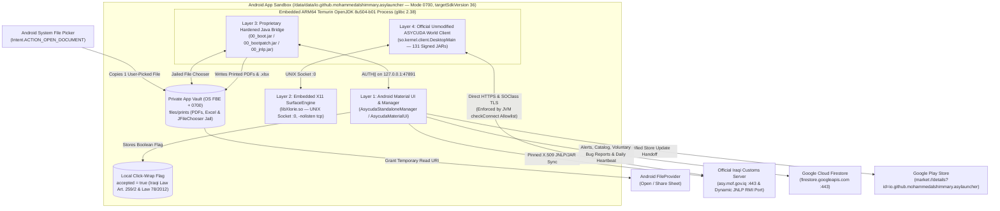

# Security Policy & Architecture Transparency

**AsyLauncher — Launcher for ASYCUDA** (`io.github.mohammedalshimmary.asylauncher`) is an independent, privately developed Android compatibility utility built by **Mohammed Ammar Hussein** to run the ASYCUDA World desktop client on mobile devices. **It is NOT affiliated with, sponsored by, or endorsed by the Iraqi Ministry of Finance, the General Commission of Customs, or UNCTAD.**

Because customs brokers and trade operators handle sensitive commercial declarations and credentials, the Android host layer (`lorie/`, `lorie-app/`) is published in this repository so security auditors and IT administrators can inspect the permissions, filesystem boundaries, network validators, and cryptographic checks directly.

---

## Current Release & Cryptographic Verification (`v4.4.1`)

Every asset published on the [official `v4.4.1` GitHub Release](https://github.com/MohammedALShimmary/ASYCUDA-Iraq-Android/releases/tag/v4.4.1) can be verified via `sha256sum`:

| Release Asset | Purpose | SHA-256 Checksum |
| :--- | :--- | :--- |
| [**`AsyLauncher_v4.4.1.apk`**](https://github.com/MohammedALShimmary/ASYCUDA-Iraq-Android/releases/download/v4.4.1/AsyLauncher_v4.4.1.apk) | Signed Android release APK (`io.github.mohammedalshimmary.asylauncher`, `versionCode 57`, `targetSdkVersion 36`) | `d93596bd8d4b4cd5c45ca013706ac377379b6b2dfa073af3c552f3740e46a7da` |
| [**`sbom.cdx.json`**](sbom.cdx.json) | CycloneDX 1.5 Software Bill of Materials (Android Maven + ARM64 Runtime + Client JARs) | Tracked in repository root |

### Official APK X.509 Signing Certificate (`apksigner verify --print-certs`)

| Field | Value |
| :--- | :--- |
| **Application ID** | `io.github.mohammedalshimmary.asylauncher` |
| **Version Name / Code** | `4.4.1` (`versionCode 57`) |
| **Signer Certificate DN** | `CN=Mohammed Ammar Hussein, OU=Logistics and Customs Software, O=ASYCUDA Iraq Open Source, L=Baghdad, ST=Baghdad, C=IQ` |
| **Signer SHA-256 Digest** | `d302d4d050fb986e4088dd3e684c90662d00da748dde8da3d4966baea02da023` |
| **Signer SHA-1 Digest** | `e1b9c91b50e50223885fd2ee5326b165f16535e7` |

---

## 1. 4-Layer Security Architecture & Data-Flow Matrix

The application separates Android UI management, X11 display rendering, the Java compatibility bridge, and the official ASYCUDA World client into four distinct layers:

| Layer | Component | Location | Trust & Storage Boundary | Network Access |
| :--- | :--- | :--- | :--- | :--- |
| **Layer 1: Android Host, UI & Security Validator** | `MainActivity`, `AsycudaStandaloneManager`, `AsycudaMaterialUi`, `AsycudaFirebaseManager`, `AsycudaSecurityValidator` | `lorie/src/main/java/com/termux/x11/` | Runs inside the Android app UID (`0700` `/data/data/io.github.mohammedalshimmary.asylauncher/`, `targetSdkVersion 36`). Requests zero broad storage or package-installer permissions (`MANAGE_EXTERNAL_STORAGE`, `REQUEST_INSTALL_PACKAGES`, and `REQUEST_IGNORE_BATTERY_OPTIMIZATIONS` removed). Stores first-launch Terms acceptance strictly as a local boolean flag (`accepted = true`). | • `asy.mof.gov.iq:443` (JNLP/JAR sync) • `firestore.googleapis.com:443` (Announcements, Known-Errors Catalog sync, voluntary redacted bug reports, and once-per-day 6-field anonymous heartbeat) • `sonarcloud.io` / `snyk.io` (About dialog badges) |
| **Layer 2: Native X11 Display Surface** | `libXlorie.so` (Termux:X11) | `lorie/src/main/cpp/` | Renders the local UNIX domain X11 socket (`files/usr/tmp/.X11-unix/X0`, `0700`) onto an Android `SurfaceView` with TCP listening disabled (`-nolisten tcp`) and loopback-only binding (`INADDR_LOOPBACK` without `SO_REUSEPORT`). | **None** (100% local UNIX socket, `-nolisten tcp`) |
| **Layer 3: Proprietary Hardened Java Compatibility Engine** | `00_bootpatch.jar`, `00_boot.jar`, `00_jnlp.jar` | Proprietary R8-Obfuscated & String-Encrypted Binaries (Bundled in APK `assets/`) | Intercepts desktop printing (`ASYCUDA_PDF_Printer`), native Excel table exports (`ASYCUDA_Excel_Exporter`), `.so` document previews, and `JFileChooser` file imports inside the JVM. Verifies host APK package path and official X.509 signing certificate SHA-256 (`verifyHostApkIntegrity()`) before booting, encrypts proprietary string literals at build time, jails all files to `files/prints` (OS FBE + `0700` UID Sandbox), blocks JVM access to Android host paths (`/shared_prefs`, `known_errors_catalog.json`, `/proc/self/environ`), builds a composite OpenJDK 8 TLS TrustStore (`mof_cacerts.jks`), and enforces a strict JVM `SecurityManager` (`checkConnect` outbound network allowlist restricting sockets to `localhost` and `asy.mof.gov.iq`). Layer 1 pipes JVM `stdout`/`stderr` through `AsycudaSecurityValidator.redactSensitiveLogContent()` in RAM before writing to `asycuda.log` (and cleans up `.log` files on graceful exit). Communicates with Layer 1 over `127.0.0.1:47891` using per-session `AUTH|<UUID>|` constant-time `MessageDigest.isEqual` authentication. | **None** (`127.0.0.1:47891` loopback only) |
| **Layer 4: Official ASYCUDA World Client** | `so.kernel.client.DesktopMain` (131 signed `.jar` files) | Downloaded on first launch from ``https://asy.mof.gov.iq/aw/AWIQWorld.jnlp`` (Iraq-network restricted) | Zero government JARs are bundled in the APK. Downloaded directly from `asy.mof.gov.iq` and verified against UNCTAD/StrategyObject's pinned X.509 certificate (`META-INF/SOCODE.RSA`). Handles all customs logins, declarations, and tariff tables. | Direct connection to **`asy.mof.gov.iq:443`** and the dynamic RMI port parsed from `AWIQWorld.jnlp` (enforced at runtime by `AsycudaBoot.checkAllowedOutboundNetwork()`) |

---

## 2. Zero Storage Permissions, Unified Private Vault & Automatic File Picker Bridge

1. **Zero Broad Storage, Accessibility, or Package-Installer Permissions (`AndroidManifest.xml`)**:
   - `MANAGE_EXTERNAL_STORAGE`, `READ_EXTERNAL_STORAGE`, `WRITE_EXTERNAL_STORAGE`, `ACCESS_WIFI_STATE`, `CHANGE_WIFI_STATE`, `CHANGE_NETWORK_STATE`, `BIND_ACCESSIBILITY_SERVICE`, `REQUEST_INSTALL_PACKAGES`, and `REQUEST_IGNORE_BATTERY_OPTIMIZATIONS` are completely absent from [`lorie/src/main/AndroidManifest.xml`](lorie/src/main/AndroidManifest.xml) (enforced on every commit by [`scripts/SecurityVerificationTest.java`](scripts/SecurityVerificationTest.java)).
   - Below are all **7 permissions** declared in `AndroidManifest.xml` and their exact engineering purpose:

   | Declared Permission | Android Protection Level | Exact Engineering Purpose |
   | :--- | :--- | :--- |
   | `android.permission.INTERNET` | Normal | Connects directly to `asy.mof.gov.iq`, runs connection diagnostics, and communicates with Cloud Firestore over HTTPS. |
   | `android.permission.ACCESS_NETWORK_STATE` | Normal | Monitors active network transport changes during `AWIQWorld.jnlp` package synchronization and diagnostics. |
   | `android.permission.FOREGROUND_SERVICE` | Normal | Keeps the embedded X11 display server and ASYCUDA JVM alive while the user switches briefly to another app (e.g., viewing an exported PDF or copying a 2FA code). |
   | `android.permission.FOREGROUND_SERVICE_SPECIAL_USE` | Normal (Android 14–16 / SDK 36) | Required by Android 14–16 (`targetSdkVersion 36`) for persistent local desktop/X11 sessions. |
   | `android.permission.WAKE_LOCK` | Normal | Prevents CPU sleep during active customs declaration work or multi-JAR synchronization. |
   | `android.permission.POST_NOTIFICATIONS` | Runtime (Optional) | Displays the foreground X11 session status notification (with a quick `Exit` action button). |
   | `io.github.mohammedalshimmary.asylauncher.PERMISSION_INTERNAL_BROADCAST` | `signature` (App-Private) | Custom `signature`-level permission protecting internal X11 surface state broadcasts between `CmdEntryPoint` and `MainActivity` so no third-party app can spoof or intercept display intents. |

2. **Automatic File Picker Bridge (`VaultFileSystemView` Jail)**:
   - Because the legacy ASYCUDA Java 8 Swing client uses `javax.swing.JFileChooser` and `java.awt.FileDialog` (which cannot invoke Android `content://` intents directly), `00_boot.jar` jails `JFileChooser` and `FileDialog` to the private Vault directory (`/data/data/io.github.mohammedalshimmary.asylauncher/files/prints`) via `VaultFileSystemView`, preventing traversal to parent system folders while allowing subfolder navigation inside the Vault.
   - No custom buttons are injected into government dialogs. When ASYCUDA opens its file chooser, `00_boot.jar` sends `AUTH|<token>|PICK_WORKSPACE_FILE` over `127.0.0.1:47891` to `AsycudaStandaloneManager`, which displays an Android prompt (`showFilePickerBridgePromptModal`) letting the user either **Import a new file from their phone into the Vault** (`Intent.ACTION_OPEN_DOCUMENT`) or **Select an existing file in the Vault**.
   - When a file is imported, only that single user-selected file is copied into `files/prints/` and automatically highlighted inside the open Java `JFileChooser`.

3. **Private Vault — File Manager & Upload Staging Exclusion**:
   - All printed PDFs, exported `.xlsx` tables, and imported attachments stay inside `/data/data/io.github.mohammedalshimmary.asylauncher/files/prints` (OS File-Based Encryption + `0700` UID sandbox). Nothing is written to public `/storage/emulated/0/Download`.
   - Inside the **Vault — File Manager** (`showVaultFileManagerModal`), users can create subfolders, navigate folders, **Rename**, **Copy**, **Move**, **Open**, **Share** (files only—folders cannot be shared), or **Delete** items.
   - **Upload Staging Exclusion**: Temporary `soems*ems` and `prn*xc` upload staging files in `/client/tmp/` (and any file already present in the Vault tree by name+size or SHA-256 digest via `isFileAlreadyInVault`) are ignored by the export watcher so uploading an attachment to the server never triggers duplicate Vault saves.

4. **Google Play Store Handoff for App Updates (`Zero REQUEST_INSTALL_PACKAGES`)**:
   - When checking for app updates in the **Update Center** (`runUnifiedUpdateCheckModal()`), the launcher checks Cloud Firestore (`AsycudaFirebaseManager.getCachedRemoteVersionTag()`) and opens the verified **Google Play Store** listing (`market://details?id=io.github.mohammedalshimmary.asylauncher`, validated by `isTrustedAnnouncementUrl()`) without requesting `REQUEST_INSTALL_PACKAGES` or downloading raw `.apk` files inside the app.

---

## 3. Data Privacy, Iraqi Law Click-Wrap Liability Waiver & External Network Inventory

1. **Zero Credential & Zero Personal Data Collection**:
   - The Android host never intercepts, stores, or transmits ASYCUDA World usernames, passwords, TIN codes, or declaration data, and never reads `Settings.Secure.ANDROID_ID`.
   - All authentication and customs operations happen directly between the official client (`so.kernel.client.DesktopMain`) and `asy.mof.gov.iq` (`:443` and the dynamic RMI port parsed from `AWIQWorld.jnlp`), enforced at the JVM socket layer by `AsycudaBoot.checkAllowedOutboundNetwork()`.
   - Clipboard synchronization is strictly one-way (`Android -> ASYCUDA` paste only), and native X11 keystroke/clipboard logging is disabled in `activity.cpp` and `LorieView.java`.

2. **First-Launch Click-Wrap Liability Waiver Under Iraqi Law (Local Boolean Flag Only)**:
   - On first launch, the app presents a mandatory **Click-Wrap Terms & Conditions and Contractual Liability Waiver** (`showTermsAndConditionsModal()`):
     - **Article 259(2) of the Iraqi Civil Code No. 40 of 1951 (`المادة 259/2 من القانون المدني العراقي رقم 40 لسنة 1951`)**: Permits contractual exemption from liability (`يجوز الاتفاق على إعفاء المدين من أية مسؤولية تترتب على عدم تنفيذ التزامه التعاقدي...`), reinforced by the gratuitous (`تبرعي / بدون عوض مالي`) nature of this free software.
     - **Article 18(1) & Article 13 of the Iraqi Electronic Signature and Electronic Transactions Law No. 78 of 2012 (`قانون التوقيع الإلكتروني والمعاملات الإلكترونية العراقي رقم 78 لسنة 2012`)**: Recognizes the binding legal validity of electronic click-wrap acceptance (`الإيجاب والقبول الإلكتروني`).
   - Because `AsycudaStandaloneManager.java` blocks the runtime from booting until `hasAcceptedTerms(activity)` is `true`, running the app constitutes conclusive proof of acceptance. Acceptance is stored solely as a local boolean flag (`accepted = true`) on the device — zero personal data or consent receipts are ever transmitted.

3. **Universal Network Diagnostics, In-RAM Redaction & 3-Layer Hardened Cloud Firestore**:
   - **100% In-RAM Diagnostic Ring Buffer & Auto-Zeroing**: Both the Universal Error & Network Diagnostics Window and the *"Report a Technical Issue"* dialog assemble logs strictly in RAM (`sRedactedRamDiagRingBuffer` and `buildDiagnosticPreviewBufferInRam()`), provide a `"Full RAM Preview"` button (`showDiagnosticDataPreviewModal()`), and overwrite every character of the `StringBuilder` buffer with `'\0'` upon dialog dismissal.
   - **Deterministic Credential Scrubber (`AsycudaSecurityValidator.redactSensitiveLogContent`)**: Scrubs local IPC tokens, URL credentials, `Bearer`/`Basic` headers, `.SOClassCache` username paths, `Tin code received` lines, XML/SOAP auth tags (`<password>`, `<user>`, `<username>`, `<tin>`, `<declarant>`, `<token>`, `<jsessionid>`), and both quoted JSON strings and unquoted key-value patterns for credentials and tokens.
   - **Data-Only Remote Known-Errors Catalog (`known-errors-catalog.json`)**: Pre-bundled inside `asycuda-iraq.tar.xz` and synced read-only from Cloud Firestore (`app_config/known_errors_catalog`), validated against a hardcoded allowlist of `verifiedFixId` constants (`ALLOWED_VERIFIED_FIX_IDS`) and field-length bounds (`validateKnownErrorsCatalogJson()`) with zero dynamic code execution, stored `0600` owner-only in `files/known-errors-catalog-remote.json`, and blocked from JVM access by `checkBlockedHostPath()`.
   - **Wi-Fi ISP Firewall Detection & 4G Guidance**: If the diagnostics tool detects that a user's Wi-Fi ISP is blocked by the Ministry of Finance firewall, it explains the issue and provides a shortcut to Android Wi-Fi Settings so the user can switch to Mobile Data (4G) without the app requesting `CHANGE_NETWORK_STATE` or running any network relay.
   - **Pre-Disk JVM Log Redaction Pipe**: `AsycudaStandaloneManager` pipes embedded OpenJDK `stdout`/`stderr` through an in-RAM reader (`startRedactedJvmLogPump`) that runs `AsycudaSecurityValidator.redactSensitiveLogContent()` on every line before persisting to 256 KB-capped `asycuda.log`, and deletes `asycuda.log`, `client.log`, and `boot_debug.log` on graceful exit.
   - **3-Layer Cloud Firestore Hardening & Heartbeat Opt-Out**: Protected by (1) [`firestore.rules`](firestore.rules) enforcing write-only isolation on `diagnostic_reports` and `app_metrics` (`allow read, update, delete: if false`) and strict schema validation, (2) GCP API Key Android application + SHA-1 certificate restriction, and (3) runtime release signing certificate verification (`isAuthorizedOfficialBuild` + `X-Android-Cert` header in `AsycudaFirebaseManager.java`). Users can opt out of the once-per-day 6-field anonymous installation heartbeat anytime inside **About, Security & Software Licences**.

4. **External Network Endpoints Inventory**:

   | Hostname / Endpoint | Protocol | Direction | Purpose & Data Transmitted |
   | :--- | :--- | :--- | :--- |
   | **`asy.mof.gov.iq`** (`:443` & dynamic RMI port from `AWIQWorld.jnlp`) | HTTPS / SOClass TLS | Read/Write | Official Iraqi General Commission of Customs ASYCUDA World server (`AWIQWorld.jnlp`, signed `.jar` packages, and live customs session). |
   | **`firestore.googleapis.com`** (`projects/<FIREBASE_PROJECT_ID>`) | HTTPS (`443`) | Read (`announcements`, `app_config`) / Write-Only (`diagnostic_reports`, `app_metrics`) | Fetches News & Release Alerts and Known-Errors Catalog definitions; accepts voluntary redacted bug reports and once-per-day 6-field anonymous installation heartbeats. |
   | **`sonarcloud.io`** & **`snyk.io`** | HTTPS (`443`) | Read-Only (`GET`) | Queries public code-quality badge status only when the user opens the **About, Security & Software Licences** dialog. |

---

## 4. Proprietary Java-to-Android Compatibility Engine (`00_boot.jar`) & Runtime Provenance

The three compatibility archives (`00_bootpatch.jar`, `00_jnlp.jar`, and `00_boot.jar`) are proprietary, R8-obfuscated components (`Copyright © 2026 Mohammed Ammar Hussein — All Rights Reserved`) provided free of charge inside official signed builds of `AsyLauncher`:

| Bridge Archive | SHA-256 Digest | Engineering Role & Security Controls |
| :--- | :--- | :--- |
| **`00_bootpatch.jar`** | `0af8b1c59ce1b1c5459c719e7804d7348d444ace1133d9bef09e94699cce6551` | Loaded via `-Xbootclasspath/p:00_bootpatch.jar` (R8-obfuscated + build-time string-encrypted). Intercepts `Desktop.getDesktop().open(File)` and `.browse(URI)` inside the headless Linux JVM and forwards them to `AsycudaBoot.handleDesktopAction()`. |
| **`jars/00_jnlp.jar`** | `87ab3bf63a68ea203e0bf7d5eff9e9d232e41b14e9a55f4a20c0899dbd41be56` | R8-obfuscated + build-time string-encrypted. Supplies the `javax.jnlp.ServiceManager` and `BasicService` interfaces expected by `client.jar` when running outside Oracle `javaws`, routing `showDocument(URL)` to the Android bridge. |
| **`jars/00_boot.jar`** | `5a415e722c86ec88d12b6658eeb98eb937d6921dc866a94e3fc1d004d7af0fce` | R8-obfuscated + build-time string-encrypted pre-main compatibility engine that: • Verifies the host APK package path and official X.509 signing certificate SHA-256 (`verifyHostApkIntegrity()`, Scheme v2/v3 + v1 fallback) before executing `main()` or forwarding `handleDesktopAction()` calls, blocking repackaged/cloned APKs from reusing the proprietary bridge. • Registers a pure-Java vector PDF 1.4 print service (`ASYCUDA_PDF_Printer`, including Previous Declaration `PD` print restoration and Final Declarations table print fixes) and an OpenXML `.xlsx` exporter (`ASYCUDA_Excel_Exporter`, hardened against `CWE-1236` spreadsheet formula injection) saving exclusively to `files/prints`. • Applies live Swing font/UI scaling (`Default` / `Comfort` / `Touch`), expanded `JInternalFrame` touch resize zones, search criteria dropdown stabilization, and single-tap `JFileChooser` selection. • Jails `JFileChooser` and `FileDialog` to `files/prints` via `VaultFileSystemView` and sends `PICK_WORKSPACE_FILE` over authenticated loopback IPC. • Watches for temporary `.so` files exported by ASYCUDA (excluding `soems*ems` / `prn*xc` upload staging files), detects their file type (`PDF`, `XLSX`, `DOCX`, `XML`, `JPG`, `PNG`) via magic-byte headers and SHA-256 deduplication, and opens them on Android. • Augments OpenJDK 8 `cacerts` with `files/client/mof.crt` into a read-only JKS trust store (`mof_cacerts.jks` via `installMofHttpsTrustStore()`) so ASYCUDA's embedded `Help -> Index` (`https://asy.mof.gov.iq/aw/help/index.html`) loads over verified TLS. • Installs a fail-closed `SecurityManager` (`createHardenedSecurityManager()`) that **blocks OS subprocess execution** (`checkExec()` throws `SecurityException`), **blocks `PropertyPermission` write tampering**, **blocks JVM access to Android host paths and IPC state files** (`checkBlockedHostPath()` blocks `/shared_prefs`, `legal_consent_receipt.json`, `known_errors_catalog.json`, `.asycuda_display_state` writes/deletes, `/databases/`, `/datastore/`, and `/proc/self/environ`), and **enforces an outbound network allowlist** (`checkConnect()` / `checkAllowedOutboundNetwork()` restricts all JVM sockets strictly to `localhost`/`127.0.0.1` and `asy.mof.gov.iq`). • Invokes the official `so.kernel.client.DesktopMain.main(args)`. |

### Native Binary & Runtime Provenance (`jniLibs` & `runtime-arm64.tar.xz`)
1. **`lorie/src/main/jniLibs/arm64-v8a/libld_linux_aarch64.so`** (`SHA-256: 3ee21d6ee370a2b6bae6ee0cfeebd3f9255324bd34076eeafd9307799903a3cf`): GNU C Library (`glibc 2.38`) dynamic ELF linker (`ld-linux-aarch64.so.1`) from `@Maxython/glibc-packages` for ARM64, packaged inside `jniLibs/arm64-v8a/` (`16 KB` page-size aligned) so Android 10–16 (`targetSdkVersion 36`) extracts it into the SELinux `apk_data_file` execute-allowed `nativeLibraryDir`.
2. **`libXlorie.so`** (`SHA-256: 3a524eb1cf399ecc4b112d1646426987bf72149bd405913f4f39ca8a5528a3f2`): Built from source in [`lorie/src/main/cpp/`](lorie/src/main/cpp/) (`16 KB` page-size aligned).
3. **`runtime-arm64.tar.xz`** (`SHA-256: 04cdd11f4fb4ceef01ca482d78ad8e8248b3a284edb1c9133518b68fe5af1e37`): Contains the **Eclipse Temurin OpenJDK `8u504-b01` LTS** (`aarch64` Linux) JRE and standard X.Org client libraries (`libX11`, `libXext`, `libXrender`, `libXtst`, `libfreetype`).

---

## 5. Pinned Publisher Certificate, Adversarial Test Suite & Live Network Audit

### 5.1 Pinned UNCTAD/SOClass Publisher Certificate (`PINNED_MOF_SOCODE_CERT_SHA256`)
Every official ASYCUDA World JAR on `asy.mof.gov.iq/aw/` is signed by UNCTAD/StrategyObject (`META-INF/SOCODE.RSA` / `META-INF/SOCODE.SF`). Before any downloaded `.jar.tmp` file is moved into `client/jars/`, `AsycudaSecurityValidator.verifyDownloadedJarIntegrity(File jarFile)` enforces three checks:
1. Confirms the archive contains `META-INF/SOCODE.RSA` and `META-INF/SOCODE.SF` and verifies that the X.509 signer certificate SHA-256 digest matches `PINNED_MOF_SOCODE_CERT_SHA256`:
   - **Signer Subject / Issuer**: `CN=SOClass, OU=SOClass, O=Strategy Object, L=Paris, ST=France, C=FR`
   - **Pinned X.509 Certificate SHA-256**: `5614dc62a20653686934a216439c8c779cd84d58ccbc37e85dda33433f9e972d`
2. Opens `new java.util.jar.JarFile(jarFile, true)` and reads every entry stream so `JarVerifier` validates every manifest digest against `META-INF/SOCODE.SF`.
3. Inspects `je.getCertificates()` on **every non-`META-INF/` file entry** and rejects the archive if any class or resource is unsigned or signed by a different certificate.

### 5.2 Automated 7-Suite Security Verification (`scripts/SecurityVerificationTest.java`)
Executed automatically on every commit in [`.github/workflows/security-scan.yml`](.github/workflows/security-scan.yml):
- **Suite 1 (`testManifestZeroBroadPermissions`)**: Fails if `MANAGE_EXTERNAL_STORAGE`, `READ_EXTERNAL_STORAGE`, `WRITE_EXTERNAL_STORAGE`, `ACCESS_WIFI_STATE`, `CHANGE_WIFI_STATE`, `CHANGE_NETWORK_STATE`, `BIND_ACCESSIBILITY_SERVICE`, `REQUEST_INSTALL_PACKAGES`, or `REQUEST_IGNORE_BATTERY_OPTIMIZATIONS` appear in `AndroidManifest.xml`.
- **Suite 2 (`testJnlpUrlAndPortAllowlist`)**: Verifies that `resolveTrustedMofJarUrl()` rejects plaintext `http://`, spoofed domains, non-443 ports, and `..` path traversal.
- **Suite 3 (`testUnsignedAndTamperedJarRejection`)**: Verifies that unsigned, directory-only unsigned, and `META-INF`-only JARs are rejected.
- **Suite 4 (`testBridgeAuthAndPathTraversal`)**: Verifies that unauthenticated localhost IPC commands and `../../` file paths are rejected, and that `AsycudaStandaloneManager` enforces `MessageDigest.isEqual` and loopback UID peer verification.
- **Suite 5 (`testCredentialAndPiiRedaction`)**: Verifies that URL credentials, XML `<login>`/`<password>` tags, `TIN`, `jsessionid`, `Authorization: Bearer ...`, bridge tokens, and JSON/key-value credentials are 100% redacted.
- **Suite 6 (`testZeroPiiIraqiLawWaiverAndInRamPreview`)**: Verifies the Iraqi Civil Code Art. 259/2 & Law 78/2012 Art. 18 click-wrap waiver, absence of `ANDROID_ID`, 100% in-RAM diagnostic preview with `\0` zeroing, and 3-layer Cloud Firestore hardening.
- **Suite 7 (`testHostIsolationNativeLoopbackAndUpdaterHardening`)**: Verifies zero hardcoded server IPs or fallback ports, native X11 `INADDR_LOOPBACK` binding without `SO_REUSEPORT`, one-way clipboard sync (`Android -> ASYCUDA` only), zero keystroke logging, and FileProvider scope restrictions.

### 5.3 Independent Live Network Traffic Verification (`PCAPdroid`)
Anyone can verify on their own Android phone (without root) that ASYCUDA login credentials and declarations connect exclusively to `asy.mof.gov.iq`:
1. Install the open-source [**PCAPdroid**](https://github.com/emanuele-f/PCAPdroid) network monitor from Google Play or F-Droid.
2. Set **App Filter** to **Launcher for ASYCUDA (`io.github.mohammedalshimmary.asylauncher`)** and tap **Start**.
3. Open **AsyLauncher**, log in, or work on a declaration, then inspect **PCAPdroid -> Connections**:
   - The ASYCUDA World session connects **exclusively** to **`asy.mof.gov.iq:443`** and the dynamic RMI port from `AWIQWorld.jnlp`, plus `firestore.googleapis.com:443` for announcements, the Known-Errors Catalog, and the once-per-day 6-field anonymous heartbeat.

---

## 6. Reporting a Vulnerability

If you discover a security vulnerability, please open an issue on [GitHub Issues](https://github.com/MohammedALShimmary/ASYCUDA-Iraq-Android/issues) or email **Mohammed Ammar Hussein** (`muhammed.ammar.1997@gmail.com`).
